<p align="center">
  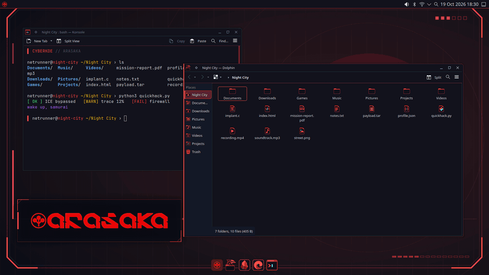
</p>

<h1 align="center">CyberKDE</h1>

<p align="center">
  <b>A cyberpunk theme for KDE Plasma 6, inspired by the menus of Cyberpunk 2077.</b><br>
  <code>SYS://CYBERKDE</code> · Plasma 6 · Wayland · 14 corporations · graphical panel · fully reversible
</p>

<p align="center">
  <a href="README.pt-BR.md">Leia em português</a> ·
  <a href="#install">Install</a> ·
  <a href="#the-panel">Panel</a> ·
  <a href="#commands">Commands</a> ·
  <a href="#credits-and-trademarks">Credits</a>
</p>

I made this theme for my own desktop and decided to share it. It changes the colors, the windows, the icons, the terminal, the cursor, the sounds and the login screen, and adds animations everywhere. Turn it on with `cyberkde on`; `cyberkde off` puts everything back the way it was.

> Fan project, not affiliated with CD PROJEKT.

<p align="center">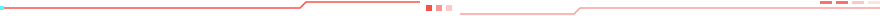</p>

## Corporations

`SYS.01 // CORP.SELECT`

A corporation changes the whole theme at once: the accent color, the secondary color, the alert color, the tint of the dark surfaces, the menu-button icon, the startup-splash logo and the wallpaper. In the panel, hovering a card previews its palette before anything is applied; when you confirm, the interface glitches and settles into the new palette.

<p align="center">
  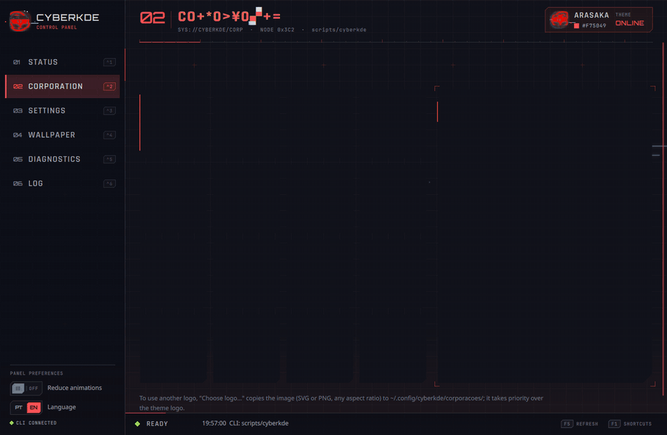
</p>

<p align="center">
  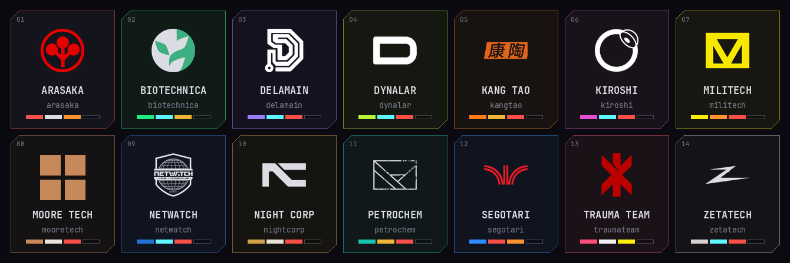
</p>

```bash
cyberkde corp militech     # apply a corporation (the login screen, which needs sudo, asks for the password at the end)
cyberkde corp --lista      # all of them, with their colors
cyberkde corp nenhuma      # back to the theme's own palette
```

The palettes live in `tokens/corporacoes.json` (the single source for the CLI and the panel): edit it and run `cyberkde corp <id>` again. A color picked by hand with `cyberkde cor '#hex'` changes only the accent. To use a different logo, put `<id>.svg` or `.png` (menu icon) and `<id>-logo.svg` or `.png` (splash; `<id>-logo-escuro` for dark backgrounds) in `~/.config/cyberkde/corporacoes/`, or use the panel's "Choose logo…" button. Those images stay on your machine, and `cyberkde uninstall` leaves them in place.

<p align="center"></p>

## The panel

`SYS.02 // CONTROL.PANEL`

Everything the CLI does is also in a graphical panel, opened with `cyberkde painel` or from the application menu (even with the theme off). It turns the theme and each part on and off, picks a corporation or a color, builds its settings page by itself from the CLI's list of effects, changes the wallpaper, runs the diagnostics and keeps a log of everything it applied. It speaks English and Portuguese.

The interface speaks the theme's own language: the startup assembles the corporation logo in slices, each section comes in with its frames tracing and its cards lighting up, and switching corporations goes through a glitch that reveals the new palette. "Reduce animations" (or the theme's "minimal" motion) turns all of it off.

<p align="center">
  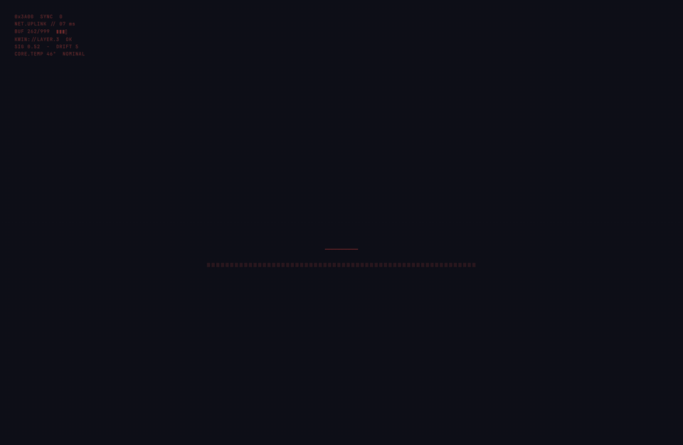
</p>

**Sections.** Every section change traces the frames from the corner, lights the cards in sequence and decodes the title.

<p align="center">
  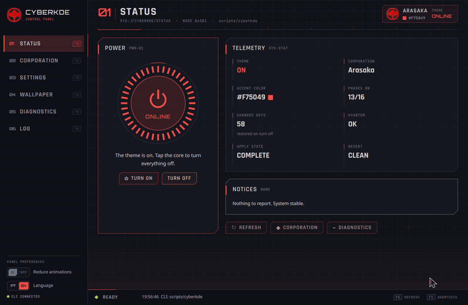
</p>

**Applying a corporation.** The chosen card shows its palette, a modal asks for confirmation and, once you confirm, the screen glitches, the progress bar follows the CLI and the inspector's logo reassembles.

<p align="center">
  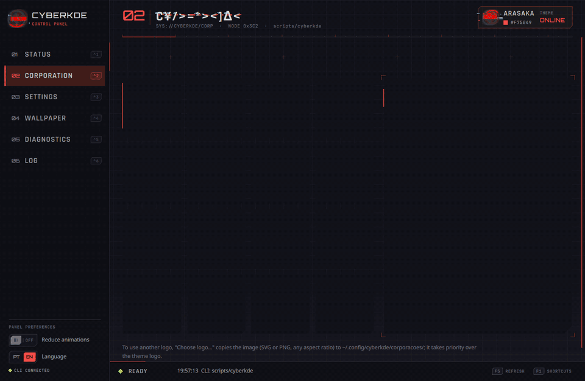
</p>

**Settings.** The motion selector, the interface presets and, in each group, the options with an animated preview: in the window gallery, each of the 21 animations plays when the mouse hovers over it.

<p align="center">
  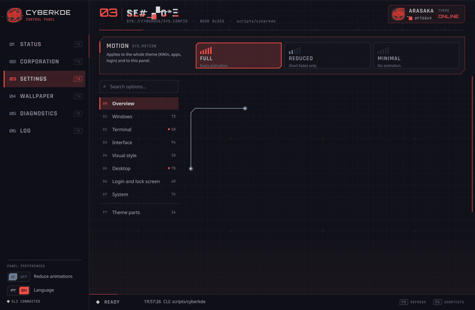
</p>

**Terminal.** The Konsole data cascade card shows a live preview; the strip height and the colors change with a click, and each change is confirmed in the corner of the screen.

<p align="center">
  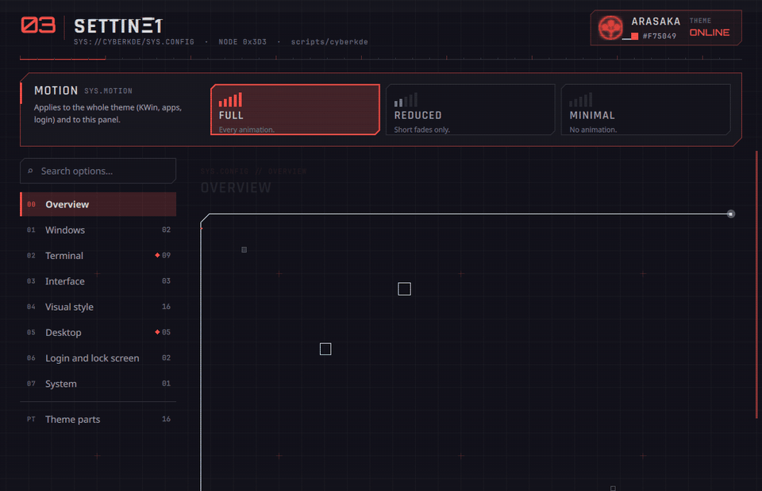
</p>

| | |
|---|---|
| 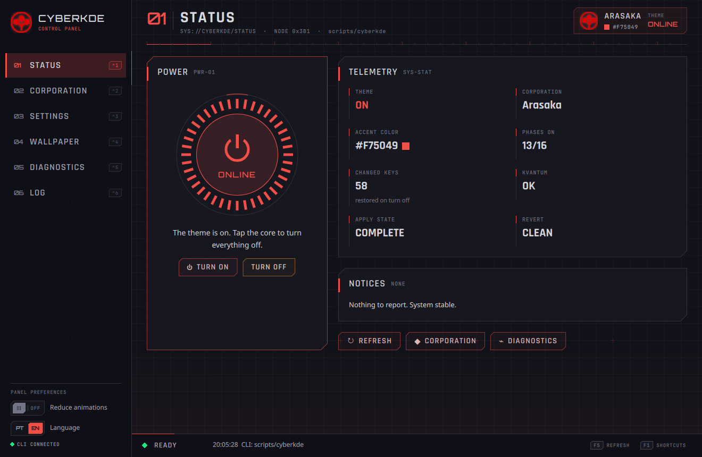 | 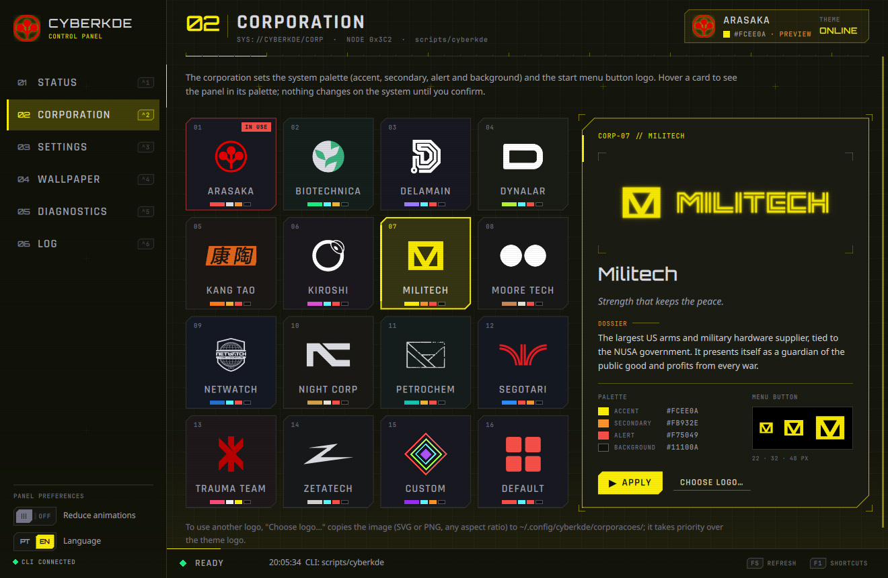 |
| 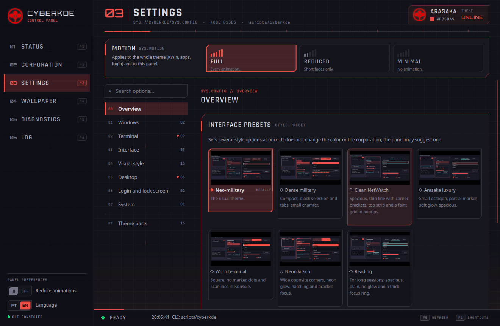 | 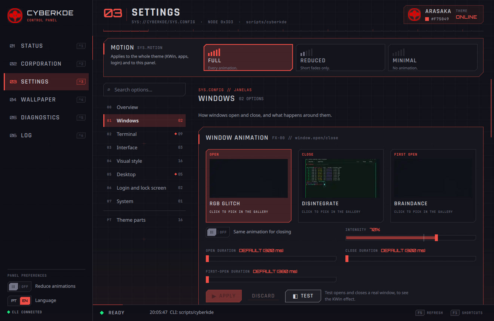 |
| 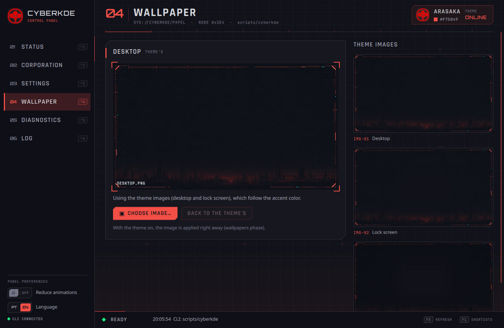 | 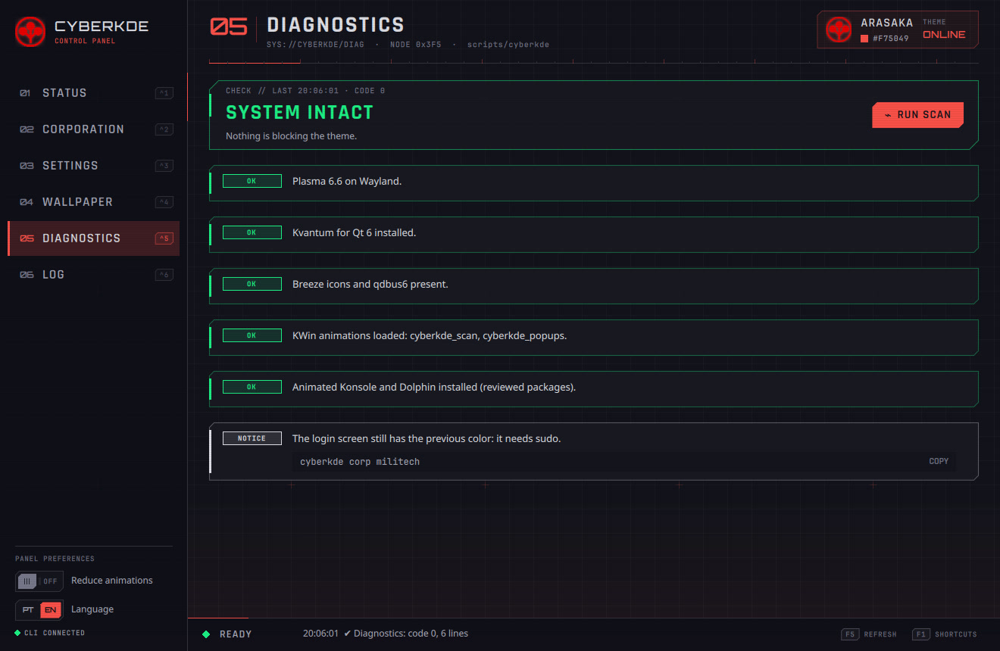 |

The panel never writes the theme configuration on its own: it only calls `cyberkde`, one command at a time, and it never asks for a password (anything that needs sudo becomes a command for the terminal).

<p align="center"></p>

## Windows

`SYS.03 // WINDOW.FX` · 21 open and close animations

<p align="center">
  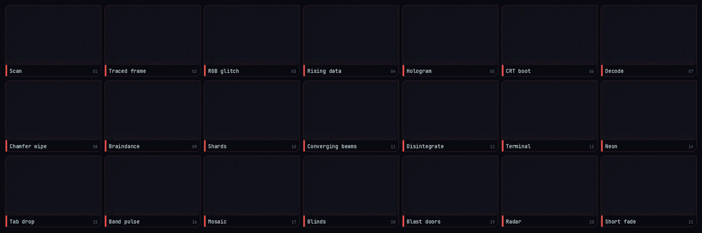
</p>

Each animation can be used on open, on close or both, with adjustable duration and intensity, and one can be reserved for the first window of each app. The window decoration (Aurorae) is chamfered, in the corporation's colors.

```bash
cyberkde efeito janelas --lista                     # all 21, with description and preview
cyberkde efeito janelas --abrir glitch --fechar crt # pick them by id
cyberkde efeito movimento reduzido                  # completo | reduzido (short fades only) | minimo (none)
```

Ids: `scan`, `moldura`, `glitch`, `dados`, `holograma`, `crt`, `decodificar`, `chanfro`, `braindance`, `cacos`, `convergir`, `desintegrar`, `terminal`, `neon`, `modal`, `pulso`, `pixel`, `persiana`, `portas`, `radar`, `fade`.

<p align="center"></p>

## Terminal

`SYS.04 // KONSOLE.FX` · data cascade + 8 effects

In the animated Konsole, the lines that scroll off the screen rise in a strip above the text, as a colored plume that breaks apart. The text is never covered.

<p align="center">
  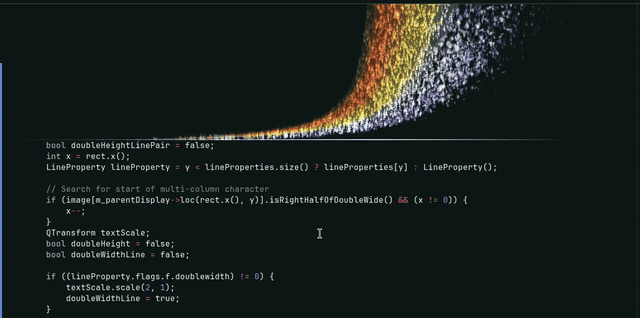
</p>

Plus eight more effects, all off by default and each with its own settings (intensity, density, theme or video colors):

<p align="center">
  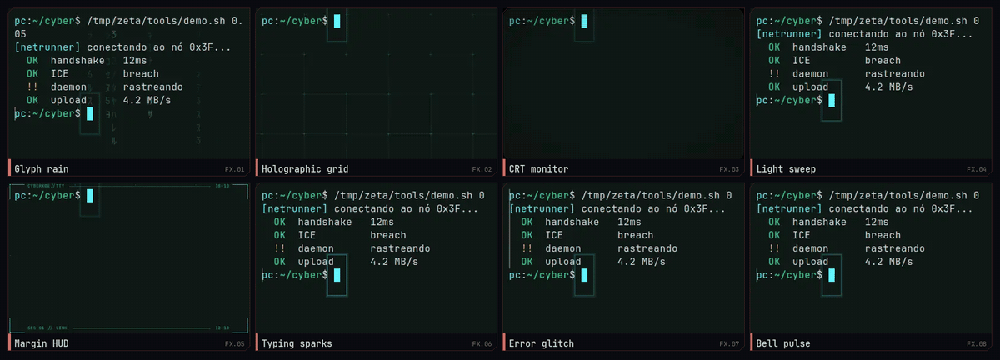
</p>

```bash
cyberkde efeito konsole-cascata on --linhas 8 --cores tema
cyberkde efeito konsole-chuva on     # also: konsole-grade, -crt, -varredura, -hud, -faiscas, -erro, -campainha
```

The terminal effects need the animated Konsole (see [Animated Dolphin and Konsole](#optional-animated-dolphin-and-konsole)). In the system Konsole, the theme applies the color scheme and the profile.

<p align="center"></p>

## Styles and presets

`SYS.05 // UI.STYLE`

The Kvantum style for the apps has 15 fine-grained settings (selection, neon glow, frame cut, density, tabs, progress bar, focus, background texture, tooltips, text fields, state colors…) and seven presets that set several of them at once.

<p align="center">
  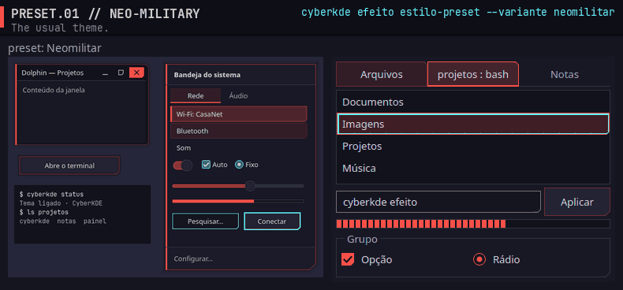
</p>

```bash
cyberkde efeito estilo-preset --variante netwatch-limpo
cyberkde efeito estilo-corte --variante octogono   # each setting: cyberkde efeito --lista shows the options
```

<p align="center"></p>

## Login, splash and lock screen

`SYS.06 // AUTH`

The login screen (SDDM), the startup splash and the lock screen follow the corporation. The panel entrance, its position, the access confirmation and the length of the splash are up to you.

<p align="center">
  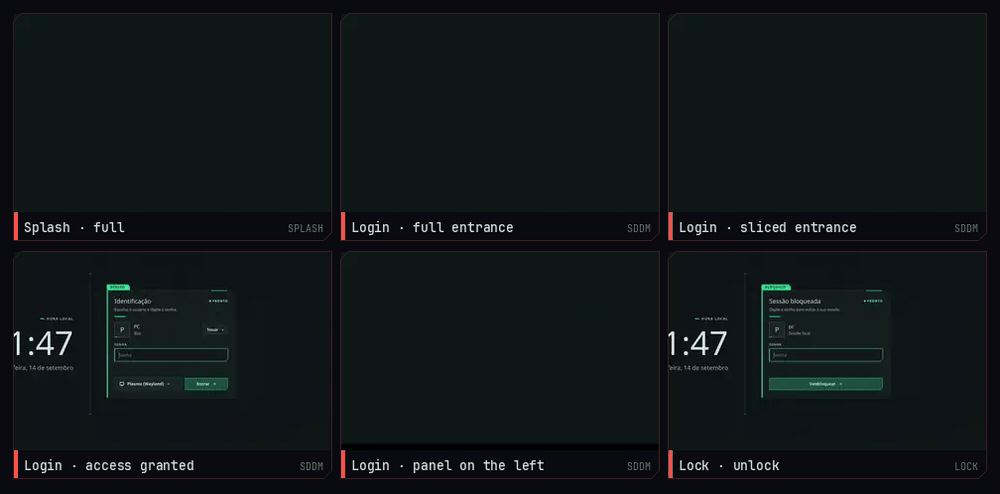
</p>

```bash
cyberkde efeito splash completo                       # completo | curto | nenhum
cyberkde efeito login --entrada fatias --painel esquerda
```

<p align="center"></p>

## Wallpapers, cursor, sounds and icons

`SYS.07 // AMBIENT`

**Wallpapers.** Four options for the desktop, the lock screen and the login screen, always in the accent color (with a corporation, its emblem goes into the background, as at the top of this page). `cyberkde papel ~/Pictures/mine.jpg` uses your own image.

<p align="center">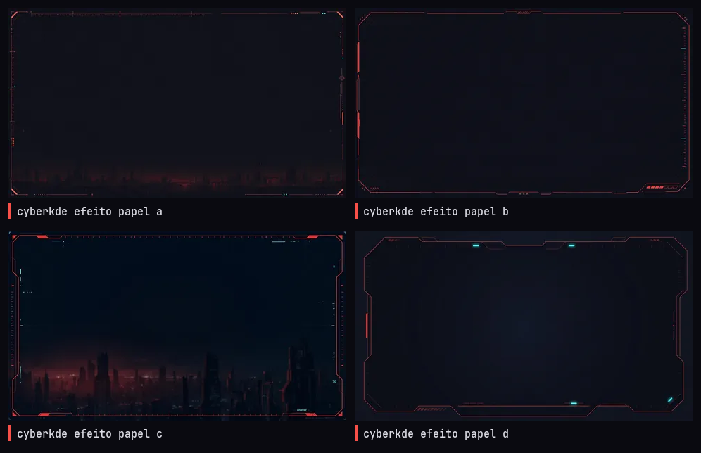</p>

**Cursor.** Cursors with corner brackets and the theme accent, in four variants: default, neon, minimal and crosshair (with a hand that closes brackets). It is an optional part: `cyberkde on cursor`.

<p align="center">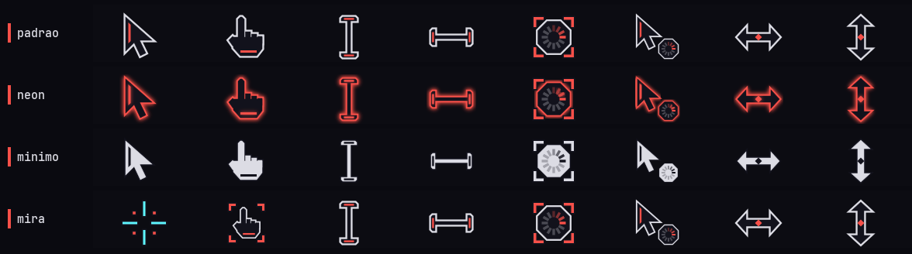</p>

**Sounds.** Quiet beeps and sweeps, synthesized for the theme, for twelve events (notification, warning, error, login, devices, trash, volume…), in a default and a subtle variant. Off by default: `cyberkde on som`.

**Icons.** Folders, places, file types and a cyborg dolphin for Dolphin; six icons have a second style you can pick one by one (`cyberkde efeito icones`). Everything else inherits Breeze Dark.

<p align="center"></p>

## What it themes

| Part | What changes |
|---|---|
| Colors + Kvantum | color scheme and a chamfered Kvantum style for all Qt/KDE apps, with 15 settings and 7 presets |
| Corporation | full palette, menu icon, splash logo and wallpaper emblem (14 corporations) |
| Layout | bar on top and a dock at the bottom; also two screens, compact and side (`cyberkde layout`) |
| Windows | Aurorae decoration and 21 open/close animations (KWin) |
| Plasma | Plasma style (panel, menus, popups, notifications), app menu as a list, a grid or full screen |
| Icons | folders, places, file types and the Dolphin dolphin; six alternative icons |
| Konsole | color scheme and profile; in the animated Konsole, the data cascade and 8 more effects |
| Login | SDDM, startup splash and lock screen, with selectable animations |
| Wallpaper | four options in the accent color, or your own image |
| Optional | cursor (4 variants), sounds (2 variants), click rings, desktops as modules |
| Panel | a graphical interface for all of the above, in English and Portuguese |

<p align="center"></p>

## Install

`SYS.08 // INSTALL`

Requirements: KDE Plasma 6, `python3`, ImageMagick, `qdbus6`, the Breeze icons and Kvantum for Qt 6. The graphical panel uses PyQt6 and a few Qt 6 QML modules.

```bash
# Ubuntu / Debian / Kubuntu
sudo apt install git python3 imagemagick qdbus-qt6 kf6-breeze-icon-theme qt-style-kvantum
# for the graphical panel (cyberkde painel):
sudo apt install python3-pyqt6 python3-pyqt6.qtqml python3-pyqt6.qtquick qml6-module-qtqml qml6-module-qtquick qml6-module-qtquick-effects \
  qml6-module-qtquick-shapes qml6-module-qtquick-dialogs qml6-module-qtquick-window
# other distributions: install the equivalent packages (the installer lists anything missing)

git clone https://github.com/jrcn1991/theme-cyberkde.git
cd theme-cyberkde
./instalar.sh --ligar    # install and switch it on (./instalar.sh only installs)
```

Before copying anything, the installer checks the requirements and the known issues below and shows how to fix each one. An item marked `✗` stops the installation. An item marked `!` should be fixed first (`--continuar` goes ahead anyway). The same check runs at any time with `cyberkde checar`.

On Ubuntu 26.04 it also offers to install [Latte Dock NG](https://github.com/jrcn1991/latte-dock-ng), the dock in the screenshots (`--sem-latte` skips it): the package built from a reviewed commit of the [jrcn1991/latte-dock-ng](https://github.com/jrcn1991/latte-dock-ng) fork of [Latte Dock NG](https://github.com/ruizhi-lab/latte-dock-ng) (itself the Plasma 6 port of KDE's [Latte Dock](https://invent.kde.org/plasma/latte-dock)), checked against a SHA-256 pinned in the theme. Latte is only offered where it has been validated end to end (Ubuntu 26.04, for now); on other systems the dock is a floating Plasma panel. Nothing is compiled on your machine. If you already use Latte, the theme uses yours.

The installation is per user. Root is only needed for the Latte package and the login screen. The program goes to `~/.local/opt/cyberkde` and the command to `~/.local/bin/cyberkde`, so you can delete the cloned folder afterwards. To update, get the new version and run `./instalar.sh` again.

### Known issues

| Issue | Fix |
|---|---|
| `cyberkde: command not found` right after installing | `~/.local/bin` only enters `PATH` at login, if the folder already exists. Log out and back in; until then, use `~/.local/bin/cyberkde` or `export PATH="$HOME/.local/bin:$PATH"`. `./instalar.sh --ligar` doesn't need this. |
| Black login screen after a reboot (Ubuntu with SDDM, no Xorg) | SDDM has to run on Wayland. `cyberkde checar` shows the file to create in `/etc/sddm.conf.d`. Not caused by the theme. |
| No animations in a virtual machine | With software rendering (llvmpipe), KWin turns every animation off. Enable 3D acceleration in the VM. `cyberkde status` tells you whether the animations are loaded. |

<p align="center"></p>

## Commands

`SYS.09 // CLI`

```
cyberkde on              # turn everything on
cyberkde off             # turn it off and restore every original value
cyberkde status          # what is on (and whether the animations loaded)
cyberkde checar          # requirements and known issues, with the fix for each
cyberkde painel          # open the graphical panel (also in the app menu, even with the theme off)
cyberkde painel --checar # only check the panel's packages and print the apt line
cyberkde on <part>       # a single part: dolphin, apps, janelas, carregamento, icones, konsole,
                         # konsole-anim, icones-sistema, kwin-extras, login, papeis-de-parede, plasma,
                         # barra-e-dock; optional (not in "on"): cursor, som, login-bloqueio
cyberkde off <part>      # switch a single part off (a key another part still uses stays as it is)
cyberkde fases           # every part, and which ones are on
cyberkde cor '#5EF6FF'   # change the accent color ('cyberkde cor padrao' = back to red);
                         # --secundaria '#hex' also sets the secondary color
cyberkde corp militech   # a corporation: palette, menu-button icon, splash logo and wallpaper
                         # (arasaka, biotechnica, delamain, dynalar, kangtao, kiroshi, militech, mooretech,
                         # netwatch, nightcorp, petrochem, segotari, traumateam, zetatech;
                         # 'nenhuma' = the theme's own palette)
cyberkde corp --lista    # every corporation and its colors
cyberkde papel ~/Pictures/mine.jpg   # use your own wallpaper ('cyberkde papel padrao' = theme's)
cyberkde layout lateral --aplicar    # arrangement: tema | duas-telas | compacto | lateral | manter
cyberkde latte           # install the reviewed Latte Dock NG package (Ubuntu 26.04)
cyberkde animados        # install the animated Dolphin and Konsole packages (Ubuntu 26.04)
cyberkde padrao dolphin  # open an app with its original look, to compare
cyberkde install         # only install/update the theme files
cyberkde uninstall       # switch off and remove everything (also: ./desinstalar.sh)

cyberkde efeito --lista  # every configurable option (39), with the command for each
cyberkde efeito janelas --abrir <id> --fechar <id>   # window open/close animation (or 'nenhuma');
                         # --primeira-vez <id>: a longer one the first time each app opens
cyberkde efeito janelas --lista      # the animations to choose from, with previews
cyberkde efeito konsole-cascata on   # "data cascade" in the animated Konsole (--linhas 2-20, --cores video|tema)
cyberkde efeito konsole-chuva on     # also: konsole-grade, -crt, -varredura, -hud, -faiscas, -erro, -campainha
cyberkde efeito estilo-preset --variante <id>        # interface preset; estilo-* = each setting
cyberkde efeito movimento reduzido   # motion: completo | reduzido (short fades only) | minimo (none)
cyberkde efeito papel corp           # theme wallpaper: a | b | c | d | corp (follows the corporation) | padrao
cyberkde efeito splash curto         # startup splash: completo | curto | nenhum
cyberkde efeito login --fundo papel  # login and lock screen: --entrada, --painel, --sucesso on|off, --fundo
cyberkde efeito icones alt           # alternative folder and trash icons (or <group>=alt)
cyberkde efeito menu grade           # app menu: lista | grade | tela-cheia
cyberkde efeito dock --indicador ponto --zoom off    # Latte Dock indicator, zoom and launch bounce
cyberkde efeito areas 4              # virtual desktops named as modules (off | 4 | 6, --nomes cyber|simples)
cyberkde efeito modal-escurecer on   # also: efeito clique on (click rings in the theme colors)
cyberkde on cursor; cyberkde efeito cursor neon      # the theme cursor (optional part): padrao | neon | minimo | mira
cyberkde on som; cyberkde efeito som discreto        # the theme sounds (optional part) and the variant
# --json: one-line answer for programs (status, fases, on, off, cor, corp, efeito, checar...);
# --lang en: messages in English
```

- **Reversible by design.** Every configuration key the theme changes is recorded with its original value the first time it is written, and every file it replaces is backed up. `cyberkde off` walks that record backwards.
- **Your panels come back too.** The bar and dock arrangement saves your Plasma panels first, and `cyberkde off` puts them back.
- **Root only for the login screen.** It lives in `/usr` and `/etc`, so `cyberkde` asks for your sudo password for that part only.
- **One theme at a time.** Switch any other global theme off before `cyberkde on`, and run `cyberkde off` before applying another one. The theme records whatever it finds when it is switched on as the "original".

### Optional: animated Dolphin and Konsole

A cascade when opening folders (Dolphin) and, in Konsole, "decoding" text with a cursor halo and trail, plus the terminal effects above. They are Dolphin and Konsole with a small patch, shipped as ready-made packages built on Ubuntu 26.04 from the same version Ubuntu ships, and checked against a SHA-256 pinned in the theme. Nothing is compiled on your machine. They sit next to the system apps (in `/opt`); the theme only points the launcher at them, and `cyberkde off` points it back.

```
cyberkde animados        # the installer offers them on Ubuntu 26.04
```

They are only offered on Ubuntu 26.04, and only while its Dolphin/Konsole version matches the package; once Ubuntu updates them, the system apps stay until a new package comes out. Without them, `cyberkde on` just skips them.

<p align="center">
  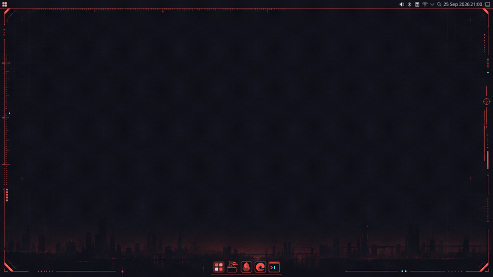
</p>

### Alongside AppleKDE

CyberKDE and [AppleKDE](https://github.com/jrcn1991/theme_apple_kde) are never mixed. If AppleKDE is on, `cyberkde on` runs `applekde off` first, checks that it really switched off, and only then applies; if it can't confirm that (AppleKDE busy, a step that needs root with no terminal), nothing is applied and it tells you what to run. `applekde on` does the same the other way around. Without AppleKDE installed, nothing changes.

## Uninstall

```bash
cyberkde uninstall       # or ./desinstalar.sh
```

Switches the theme off, restores every original value and deletes the theme files, your CyberKDE preferences and the program itself. Corporation images you put in `~/.config/cyberkde/corporacoes/` stay.

## Tested on

Kubuntu 26.04 and Ubuntu 26.04 (with Plasma installed), Plasma 6.6, Wayland; also a clean Ubuntu VM with 4 GB of RAM. Other distributions with Plasma 6 should work. Reports are welcome in the issues.

<p align="center"></p>

## Credits and trademarks

`SYS.10 // LEGAL`

- Code, generators, patches and the theme files they generate: **GPL-3.0-or-later** (see [LICENSE](LICENSE)).
- Original artwork (icons in `assets/icons`, wallpapers in `assets/wallpapers`): **CC BY-SA 4.0** (see [LICENSES/CC-BY-SA-4.0.txt](LICENSES/CC-BY-SA-4.0.txt)). The cursors and sounds are generated by the theme's own scripts.
- Rajdhani and Orbitron fonts: **SIL Open Font License 1.1** (see `assets/fonts/`).
- **Corporation logos** (`assets/corporacoes/`): trademarks of CD PROJEKT RED (Cyberpunk 2077) and/or R. Talsorian Games (Cyberpunk RED / Cyberpunk 2020), included as a non-profit fan tribute. They are not covered by the theme's licenses. The source of each file is listed in [assets/corporacoes/FONTES.md](assets/corporacoes/FONTES.md).

*Cyberpunk 2077* is a trademark of CD PROJEKT S.A. This is an independent fan project, not affiliated with or endorsed by CD PROJEKT RED or R. Talsorian Games. KDE and Plasma are trademarks of KDE e.V. Details in [CREDITS.md](CREDITS.md).
