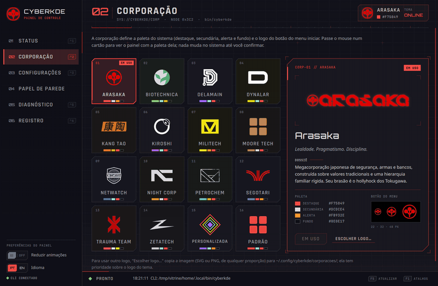
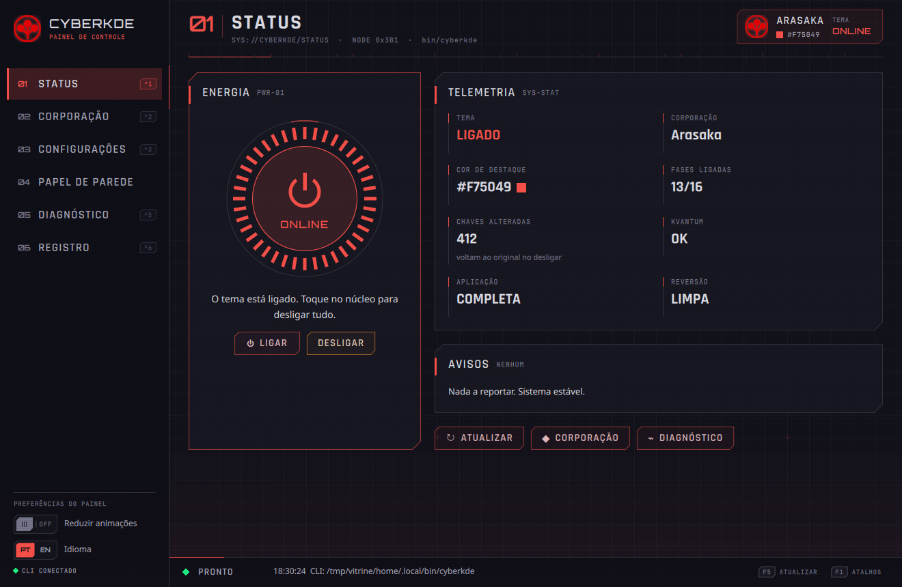
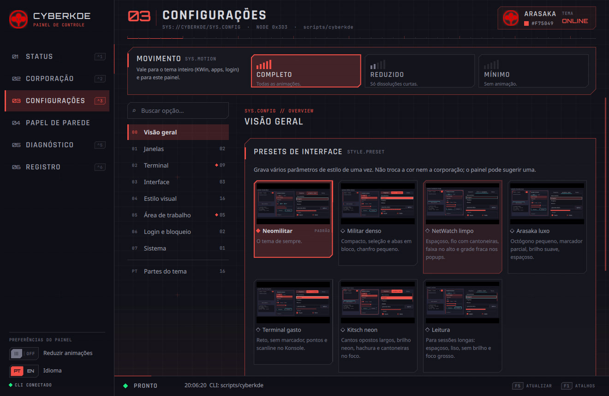
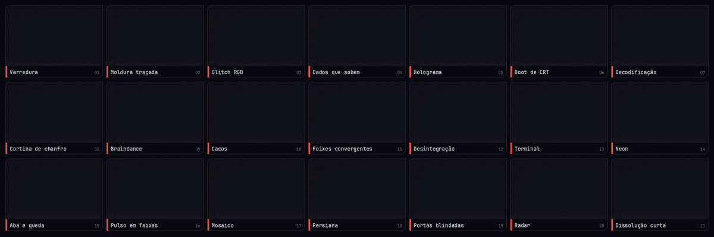
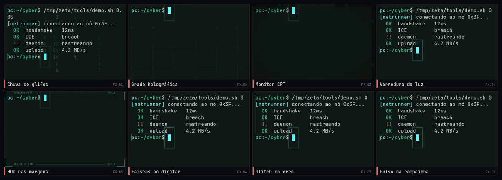
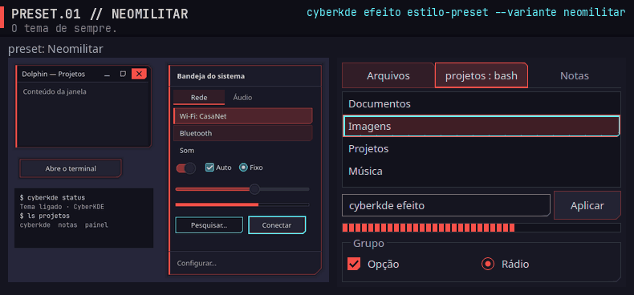
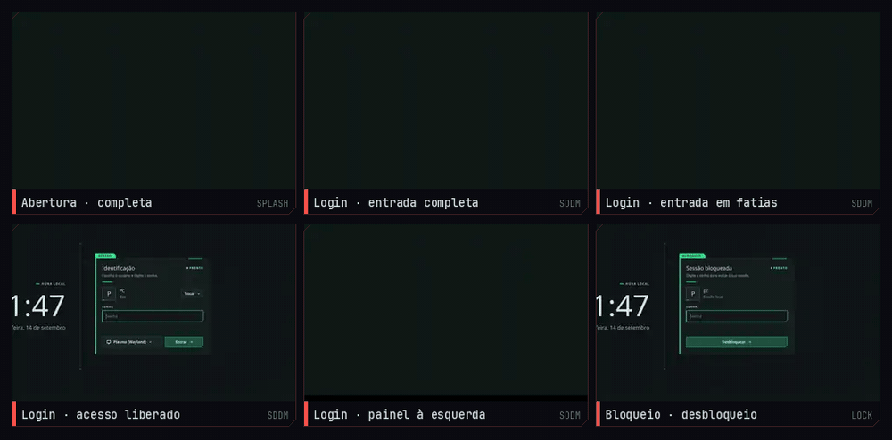

<p align="center">
  
</p>

<h1 align="center">CyberKDE</h1>

<p align="center">
  <b>Um tema cyberpunk para o KDE Plasma 6, inspirado nos menus de Cyberpunk 2077.</b><br>
  <code>SYS://CYBERKDE</code> · Plasma 6 · Wayland · 14 corporações · painel gráfico · tudo reversível
</p>

<p align="center">
  <a href="README.md">Read in English</a> ·
  <a href="#instalar">Instalar</a> ·
  <a href="#painel-de-controle">Painel</a> ·
  <a href="#comandos">Comandos</a> ·
  <a href="#créditos-e-marcas">Créditos</a>
</p>

Fiz este tema para usar no meu computador e resolvi compartilhar. Ele muda as cores, as janelas, os ícones, o terminal, o cursor, os sons e a tela de login, e coloca animações por todo lado. Liga com `cyberkde on`; o `cyberkde off` deixa tudo como estava antes.

> Projeto de fã, sem ligação com a CD PROJEKT.

<p align="center"></p>

## Corporações

`SYS.01 // CORP.SELECT`

Uma corporação troca o tema inteiro de uma vez: a cor de destaque, a secundária, a cor de alerta, o tom das superfícies, o ícone do botão do menu, o logo da tela de abertura e o papel de parede. No painel, passar o mouse num cartão mostra a paleta antes de aplicar; ao confirmar, a interface faz o glitch e assenta na paleta nova.

<p align="center">
  
</p>

<p align="center">
  
</p>

```bash
cyberkde corp militech     # aplica a corporação (o login, que precisa de sudo, pede a senha no fim)
cyberkde corp --lista      # todas, com as cores de cada uma
cyberkde corp nenhuma      # volta à paleta do próprio tema
```

As paletas ficam em `tokens/corporacoes.json` (fonte única do CLI e do painel): edite e rode `cyberkde corp <id>` de novo. Uma cor escolhida à mão com `cyberkde cor '#hex'` troca só o destaque. Para usar outro logo, ponha `<id>.svg` ou `.png` (ícone do menu) e `<id>-logo.svg` ou `.png` (abertura; `<id>-logo-escuro` para fundo escuro) em `~/.config/cyberkde/corporacoes/`, ou use o botão "Escolher logo…" do painel. Essas imagens ficam só na sua máquina, e o `cyberkde uninstall` não as apaga.

<p align="center"></p>

## Painel de controle

`SYS.02 // CONTROL.PANEL`

Tudo o que o CLI faz também está num painel gráfico, que abre com `cyberkde painel` ou pelo menu de aplicativos (mesmo com o tema desligado). Ele liga e desliga o tema e cada parte, escolhe a corporação ou uma cor, monta a página de configurações sozinho a partir da lista de efeitos do CLI (com prévias animadas de cada opção), troca o papel de parede, roda o diagnóstico e guarda o registro de tudo o que foi aplicado. Fala português e inglês e tem a opção "Reduzir animações".

| | |
|---|---|
|  |  |

O painel nunca grava a configuração do tema por conta própria: ele só chama o `cyberkde`, um comando de cada vez, e nunca pede senha (o que precisa de sudo vira um comando para o terminal).

<p align="center"></p>

## Janelas

`SYS.03 // WINDOW.FX` · 21 animações de abrir e fechar

<p align="center">
  
</p>

Cada animação vale para abrir, para fechar ou para os dois, com duração e intensidade ajustáveis, e uma pode ficar só para a primeira janela de cada app. A moldura das janelas (Aurorae) é chanfrada, nas cores da corporação.

```bash
cyberkde efeito janelas --lista                     # as 21, com descrição e prévia
cyberkde efeito janelas --abrir glitch --fechar crt # escolhe por id
cyberkde efeito movimento reduzido                  # completo | reduzido (só dissoluções curtas) | minimo (nenhum)
```

Ids: `scan`, `moldura`, `glitch`, `dados`, `holograma`, `crt`, `decodificar`, `chanfro`, `braindance`, `cacos`, `convergir`, `desintegrar`, `terminal`, `neon`, `modal`, `pulso`, `pixel`, `persiana`, `portas`, `radar`, `fade`.

<p align="center"></p>

## Terminal

`SYS.04 // KONSOLE.FX` · cascata de dados + 8 efeitos

No Konsole animado, as linhas que saem da tela sobem numa faixa acima do texto, como uma pluma colorida que se desintegra. O texto nunca é coberto.

<p align="center">
  
</p>

E mais oito efeitos, todos desligados por padrão e com parâmetros próprios (intensidade, densidade, cores do tema ou do vídeo):

<p align="center">
  
</p>

```bash
cyberkde efeito konsole-cascata on --linhas 8 --cores tema
cyberkde efeito konsole-chuva on     # também: konsole-grade, -crt, -varredura, -hud, -faiscas, -erro, -campainha
```

Os efeitos do terminal precisam do Konsole animado (veja [Dolphin e Konsole animados](#opcional-dolphin-e-konsole-animados)). No Konsole do sistema, o tema aplica o esquema de cores e o perfil.

<p align="center"></p>

## Estilos e presets

`SYS.05 // UI.STYLE`

O estilo Kvantum dos apps tem 15 ajustes finos (seleção, brilho neon, corte da moldura, densidade, abas, barra de progresso, foco, textura de fundo, dicas, campos, cores de estado…) e sete presets que gravam vários de uma vez.

<p align="center">
  
</p>

```bash
cyberkde efeito estilo-preset --variante netwatch-limpo
cyberkde efeito estilo-corte --variante octogono   # cada ajuste: cyberkde efeito --lista mostra as opções
```

<p align="center"></p>

## Login, abertura e bloqueio

`SYS.06 // AUTH`

A tela de login (SDDM), a tela de abertura e a tela de bloqueio seguem a corporação. A entrada do painel, a posição dele, a confirmação de acesso e a duração da abertura são escolhas suas.

<p align="center">
  
</p>

```bash
cyberkde efeito splash completo                       # completo | curto | nenhum
cyberkde efeito login --entrada fatias --painel esquerda
```

<p align="center"></p>

## Papéis de parede, cursor, sons e ícones

`SYS.07 // AMBIENT`

**Papéis de parede.** Quatro opções para a área de trabalho, o bloqueio e o login, sempre na cor de destaque (com uma corporação, o emblema dela entra no fundo, como no topo desta página). `cyberkde papel ~/Imagens/minha.jpg` usa uma imagem sua.

<p align="center"></p>

**Cursor.** Cursores com cantoneiras e o destaque do tema, em quatro variantes: padrão, neon, mínimo e mira (com a mão que fecha colchetes). É uma parte opcional: `cyberkde on cursor`.

<p align="center"></p>

**Sons.** Bipes e varreduras baixos, sintetizados para o tema, em doze eventos (notificação, aviso, erro, login, dispositivos, lixeira, volume…), nas variantes padrão e discreto. Desligados por padrão: `cyberkde on som`.

**Ícones.** Pastas, locais, tipos de arquivo e um golfinho ciborgue para o Dolphin; seis ícones têm um segundo estilo para escolher um a um (`cyberkde efeito icones`). O resto herda o Breeze Escuro.

<p align="center"></p>

## O que ele muda

| Parte | O que muda |
|---|---|
| Cores + Kvantum | esquema de cores e estilo Kvantum chanfrado para todos os apps Qt/KDE, com 15 ajustes e 7 presets |
| Corporação | paleta completa, ícone do menu, logo da abertura e emblema no papel de parede (14 corporações) |
| Arranjo | barra em cima e dock embaixo; também duas telas, compacto e lateral (`cyberkde layout`) |
| Janelas | moldura Aurorae e 21 animações de abrir e fechar (KWin) |
| Plasma | estilo do Plasma (painel, menus, popups, notificações), menu em lista, grade ou tela cheia |
| Ícones | pastas, locais, tipos de arquivo e o golfinho do Dolphin; seis ícones alternativos |
| Konsole | esquema de cores e perfil; no Konsole animado, a cascata de dados e mais 8 efeitos |
| Login | SDDM, tela de abertura e tela de bloqueio, com animações escolhíveis |
| Papel de parede | quatro opções na cor de destaque, ou uma imagem sua |
| Opcionais | cursor (4 variantes), sons (2 variantes), anel no clique, áreas de trabalho como módulos |
| Painel | interface gráfica para tudo isso, em português e inglês |

<p align="center"></p>

## Instalar

`SYS.08 // INSTALL`

Requisitos: KDE Plasma 6, `python3`, ImageMagick, `qdbus6`, os ícones Breeze e o Kvantum para Qt 6. O painel gráfico usa o PyQt6 e alguns módulos QML do Qt 6.

```bash
# Ubuntu / Debian / Kubuntu
sudo apt install git python3 imagemagick qdbus-qt6 kf6-breeze-icon-theme qt-style-kvantum
# para o painel gráfico (cyberkde painel):
sudo apt install python3-pyqt6 python3-pyqt6.qtqml python3-pyqt6.qtquick qml6-module-qtqml qml6-module-qtquick qml6-module-qtquick-effects \
  qml6-module-qtquick-shapes qml6-module-qtquick-dialogs qml6-module-qtquick-window
# outras distribuições: instale os pacotes equivalentes (o instalador lista o que faltar)

git clone https://github.com/jrcn1991/theme-cyberkde.git
cd theme-cyberkde
./instalar.sh --ligar    # instala e já liga (./instalar.sh só instala)
```

Antes de copiar qualquer coisa, o instalador confere os requisitos e os problemas conhecidos abaixo e mostra a correção de cada um. Um item com `✗` impede a instalação. Um item com `!` deve ser corrigido antes (com `--continuar`, segue assim mesmo). A mesma checagem roda a qualquer hora com `cyberkde checar`.

No Ubuntu 26.04, ele também oferece instalar o [Latte Dock NG](https://github.com/jrcn1991/latte-dock-ng), a dock das capturas (`--sem-latte` pula): o pacote gerado a partir de um commit revisado do fork [jrcn1991/latte-dock-ng](https://github.com/jrcn1991/latte-dock-ng) do [Latte Dock NG](https://github.com/ruizhi-lab/latte-dock-ng) (que por sua vez é a versão para o Plasma 6 do [Latte Dock](https://invent.kde.org/plasma/latte-dock) da KDE), conferido por um SHA-256 fixo no tema. O Latte só é oferecido onde foi validado de ponta a ponta (por enquanto, o Ubuntu 26.04); nos outros sistemas, a dock é um painel flutuante do Plasma. Nada é compilado na sua máquina. Se você já usa o Latte, o tema usa o seu.

A instalação é por usuário. O root só é pedido para o pacote do Latte e para a tela de login. O programa fica em `~/.local/opt/cyberkde` e o comando em `~/.local/bin/cyberkde`, então a pasta clonada pode ser apagada depois. Para atualizar, baixe a versão nova e rode `./instalar.sh` de novo.

### Problemas conhecidos

| Problema | Correção |
|---|---|
| `cyberkde: comando não encontrado` logo depois de instalar | O `~/.local/bin` só entra no `PATH` no login, se a pasta já existir. Saia e entre na sessão; até lá, use `~/.local/bin/cyberkde` ou `export PATH="$HOME/.local/bin:$PATH"`. O `./instalar.sh --ligar` não precisa disso. |
| Tela de login preta depois de reiniciar (Ubuntu com SDDM, sem Xorg) | O SDDM precisa rodar em Wayland. O `cyberkde checar` mostra o arquivo de `/etc/sddm.conf.d` a criar. Não é causado pelo tema. |
| Sem animações numa máquina virtual | Com vídeo por software (llvmpipe), o KWin desliga todas as animações. Ligue a aceleração 3D da VM. O `cyberkde status` diz se as animações estão carregadas. |

<p align="center"></p>

## Comandos

`SYS.09 // CLI`

```
cyberkde on              # liga tudo
cyberkde off             # desliga e devolve todos os valores originais
cyberkde status          # o que está ligado (e se as animações carregaram)
cyberkde checar          # requisitos e problemas conhecidos, com a correção de cada um
cyberkde painel          # abre o painel gráfico (também no menu de apps, mesmo com o tema desligado)
cyberkde painel --checar # só confere os pacotes do painel e mostra a linha do apt
cyberkde on <parte>      # só uma parte: dolphin, apps, janelas, carregamento, icones, konsole,
                         # konsole-anim, icones-sistema, kwin-extras, login, papeis-de-parede, plasma,
                         # barra-e-dock; opcionais (fora do "on"): cursor, som, login-bloqueio
cyberkde off <parte>     # desliga só uma parte (chave que outra parte ligada ainda usa fica como está)
cyberkde fases           # todas as partes, e quais estão ligadas
cyberkde cor '#5EF6FF'   # troca a cor de destaque ('cyberkde cor padrao' volta ao vermelho);
                         # --secundaria '#hex' troca também a secundária
cyberkde corp militech   # corporação: paleta, ícone do botão do menu, logo da abertura e papel de parede
                         # (arasaka, biotechnica, delamain, dynalar, kangtao, kiroshi, militech, mooretech,
                         # netwatch, nightcorp, petrochem, segotari, traumateam, zetatech;
                         # 'nenhuma' = a paleta do próprio tema)
cyberkde corp --lista    # todas as corporações e as cores de cada uma
cyberkde papel ~/Imagens/minha.jpg   # papel de parede próprio ('cyberkde papel padrao' volta ao do tema)
cyberkde layout lateral --aplicar    # arranjo: tema | duas-telas | compacto | lateral | manter
cyberkde latte           # instala o pacote revisado do Latte Dock NG (Ubuntu 26.04)
cyberkde animados        # instala os pacotes do Dolphin e do Konsole animados (Ubuntu 26.04)
cyberkde padrao dolphin  # abre um app com a aparência original, para comparar
cyberkde install         # só instala/atualiza os arquivos do tema
cyberkde uninstall       # desliga e remove tudo (também: ./desinstalar.sh)

cyberkde efeito --lista  # todas as opções configuráveis (39), com o comando de cada uma
cyberkde efeito janelas --abrir <id> --fechar <id>   # animação de abrir e fechar janelas (ou 'nenhuma');
                         # --primeira-vez <id>: uma mais longa na primeira vez que cada app abre
cyberkde efeito janelas --lista      # as animações para escolher, com as prévias
cyberkde efeito konsole-cascata on   # "cascata de dados" no Konsole animado (--linhas 2-20, --cores video|tema)
cyberkde efeito konsole-chuva on     # também: konsole-grade, -crt, -varredura, -hud, -faiscas, -erro, -campainha
cyberkde efeito estilo-preset --variante <id>        # preset de interface; estilo-* = cada ajuste
cyberkde efeito movimento reduzido   # movimento: completo | reduzido (só dissoluções curtas) | minimo (nenhum)
cyberkde efeito papel corp           # papel do tema: a | b | c | d | corp (acompanha a corporação) | padrao
cyberkde efeito splash curto         # tela de abertura: completo | curto | nenhum
cyberkde efeito login --fundo papel  # login e bloqueio: --entrada, --painel, --sucesso on|off, --fundo
cyberkde efeito icones alt           # ícones alternativos de pastas e lixeira (ou <grupo>=alt)
cyberkde efeito menu grade           # menu: lista | grade | tela-cheia
cyberkde efeito dock --indicador ponto --zoom off    # indicador, zoom e pulo ao abrir, no Latte Dock
cyberkde efeito areas 4              # áreas de trabalho como módulos (off | 4 | 6, --nomes cyber|simples)
cyberkde efeito modal-escurecer on   # também: efeito clique on (anéis no clique, nas cores do tema)
cyberkde on cursor; cyberkde efeito cursor neon      # o cursor do tema (parte opcional): padrao | neon | minimo | mira
cyberkde on som; cyberkde efeito som discreto        # os sons do tema (parte opcional) e a variante
# --json: resposta em uma linha para programas (status, fases, on, off, cor, corp, efeito, checar...);
# --lang en: mensagens em inglês
```

- **Reversível de propósito.** Cada chave de configuração que o tema muda tem o valor original registrado na primeira vez que é gravada, e cada arquivo substituído ganha uma cópia. O `cyberkde off` percorre esse registro de trás para a frente.
- **Seus painéis também voltam.** O arranjo de barra e dock guarda os painéis do Plasma antes de mudar, e o `cyberkde off` os devolve.
- **Root só para a tela de login.** Ela fica em `/usr` e `/etc`, e por isso o `cyberkde` pede a senha do sudo só nessa parte.
- **Um tema por vez.** Desligue outro tema global antes do `cyberkde on` e rode `cyberkde off` antes de aplicar outro. O tema guarda como "original" o que encontra ao ligar.

### Opcional: Dolphin e Konsole animados

Cascata ao abrir pastas (Dolphin) e, no Konsole, texto "decodificando" com halo e rastro do cursor, além dos efeitos de terminal acima. São o Dolphin e o Konsole com um patch pequeno, distribuídos como pacotes prontos, gerados no Ubuntu 26.04 a partir da mesma versão que o Ubuntu distribui e conferidos por um SHA-256 fixo no tema. Nada é compilado na sua máquina. Eles ficam ao lado dos apps do sistema (em `/opt`); o tema só aponta o atalho para eles, e o `cyberkde off` devolve.

```
cyberkde animados        # o instalador oferece no Ubuntu 26.04
```

São oferecidos só no Ubuntu 26.04 e só enquanto a versão do Dolphin/Konsole dele for a do pacote; depois que o Ubuntu os atualiza, ficam os apps do sistema até sair pacote novo. Sem eles instalados, o `cyberkde on` só os pula.

<p align="center">
  
</p>

### Junto com o AppleKDE

O CyberKDE e o [AppleKDE](https://github.com/jrcn1991/theme_apple_kde) nunca ficam misturados. Se o AppleKDE estiver ligado, o `cyberkde on` roda antes o `applekde off`, confere que ele desligou de verdade e só então aplica; se não der para confirmar (AppleKDE ocupado, etapa que pede root sem terminal), nada é aplicado e ele diz o que rodar. O `applekde on` faz o mesmo no sentido contrário. Sem o AppleKDE instalado, nada muda.

## Desinstalar

```bash
cyberkde uninstall       # ou ./desinstalar.sh
```

Desliga o tema, devolve todos os valores originais e apaga os arquivos do tema, as suas preferências do CyberKDE e o próprio programa. As imagens de corporação que você pôs em `~/.config/cyberkde/corporacoes/` ficam.

## Testado em

Kubuntu 26.04 e Ubuntu 26.04 (com o Plasma instalado), Plasma 6.6, Wayland; também numa VM limpa do Ubuntu com 4 GB de memória. Outras distribuições com Plasma 6 devem funcionar. Relatos são bem-vindos nas issues.

<p align="center"></p>

## Créditos e marcas

`SYS.10 // LEGAL`

- Código, geradores, patches e arquivos gerados do tema: **GPL-3.0-or-later** (ver [LICENSE](LICENSE)).
- Arte própria (ícones em `assets/icons`, papéis de parede em `assets/wallpapers`): **CC BY-SA 4.0** (ver [LICENSES/CC-BY-SA-4.0.txt](LICENSES/CC-BY-SA-4.0.txt)). Cursores e sons são gerados pelos scripts do tema.
- Fontes Rajdhani e Orbitron: **SIL Open Font License 1.1** (ver `assets/fonts/`).
- **Logos das corporações** (`assets/corporacoes/`): marcas da CD PROJEKT RED (Cyberpunk 2077) e/ou da R. Talsorian Games (Cyberpunk RED / Cyberpunk 2020), incluídas como homenagem de fã, sem fins lucrativos. Não estão sob a licença do tema. A origem de cada arquivo está em [assets/corporacoes/FONTES.md](assets/corporacoes/FONTES.md).

*Cyberpunk 2077* é marca da CD PROJEKT S.A. Este é um projeto independente de fã, sem ligação com a CD PROJEKT RED nem com a R. Talsorian Games e sem o endosso delas. KDE e Plasma são marcas da KDE e.V. Detalhes em [CREDITS.md](CREDITS.md).
